<h1 align="center">DurAn · NabizApp</h1>

<p align="center">
  <b>A wristband and Android app that notices addiction cravings before they peak.</b><br>
  TEKNOFEST 2026 · Technological Applications in the Fight Against Addiction · Team Stratos Root
</p>

<p align="center">
  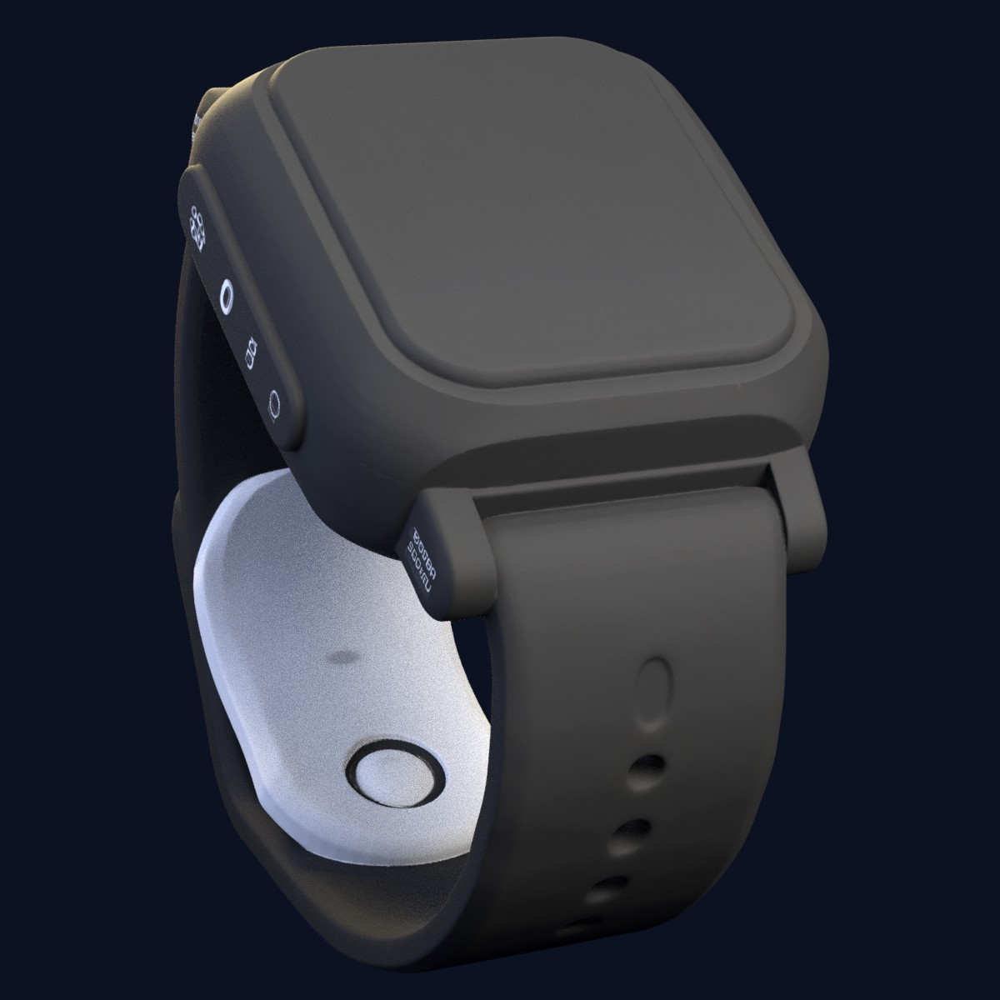
  <br>
  <sub>Concept wristband enclosure. The model is a concept study generated with Meshy v6, rendered in Blender.</sub>
</p>

DurAn fuses two **independent** signals inside a 3-minute window and escalates through three tiers of intervention
before an urge turns into action:

- **Physiological arousal** from a wristband (inter-beat intervals, skin conductance, skin temperature, motion), measured
  against the wearer's own rolling baseline.
- **Risky usage patterns** on the phone: how often a betting app comes to the foreground, detected by an Android
  `AccessibilityService`.

All processing happens on the device. Raw physiological data is never written to disk and never sent to a server.

This repository contains the **whole phone side**: the React Native app, the BLE receiver, the baseline and fusion
engines, the native Android accessibility service, storage, and the UI. The band firmware and hardware files are kept in a
separate repository, but the radio contract between them is defined here in [`docs/ble-protocol.md`](docs/ble-protocol.md).

> DurAn is not a medical device. It does not diagnose and does not replace professional treatment. In a crisis, call the
> **115 YEDAM** counseling line (Yeşilay Danışmanlık Merkezi) or **112**.

## The problem

The harmful act (gambling, substance use, smoking, screen overuse) usually happens during a craving wave of a few minutes,
and the person is often alone during those minutes. Existing support is real but arrives too late. DurAn aims to be there
during that window.

## How it works

| Tier | Trigger | Intervention |
|---|---|---|
| **1 · Awareness** | Physiological arousal only | A short awareness message and an optional one-tap label (tense, excited, didn't notice) |
| **2 · Friction** | Risky usage pattern only | "Pause for a moment before continuing" with a 10-second countdown |
| **3 · Full intervention** | Both within the same 3-minute window | 4-4 breathing circle, a coping card, and the Yeşilay **115 YEDAM** line (one-tap call) |

If one detector fails or turns noisy, the other keeps working at its own, weaker tier.

## Screenshots

### Android app

<table>
  <tr>
    <td align="center">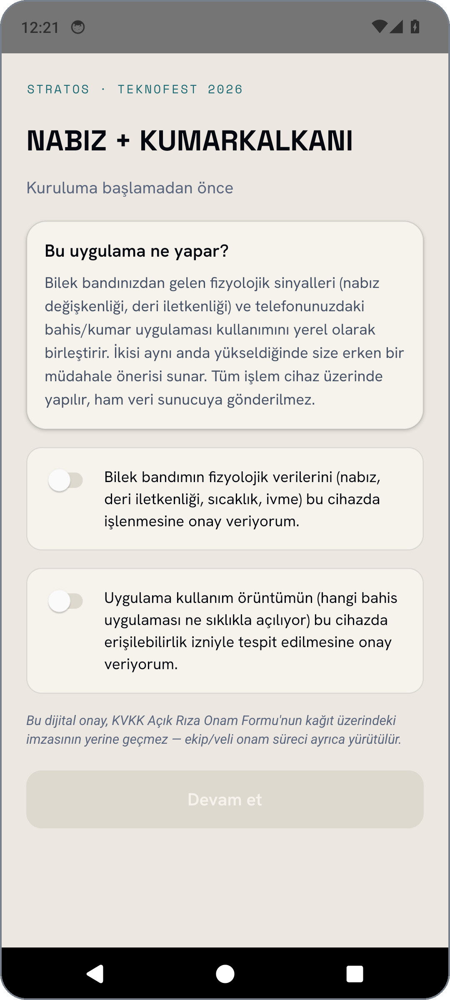<br><sub><b>Onboarding</b><br>two separate consent switches</sub></td>
    <td align="center">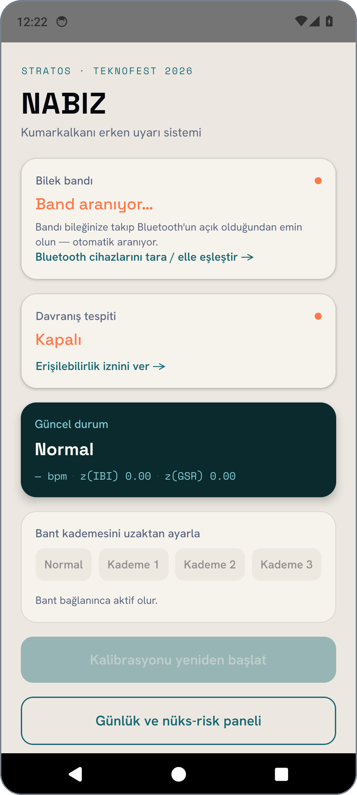<br><sub><b>Home</b><br>band, accessibility, and tier status</sub></td>
    <td align="center">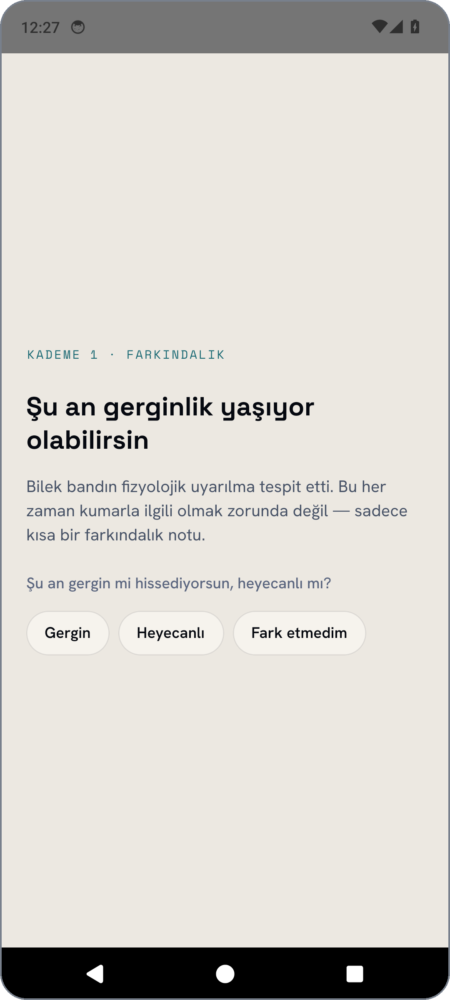<br><sub><b>Tier 1</b><br>awareness and optional label</sub></td>
  </tr>
  <tr>
    <td align="center">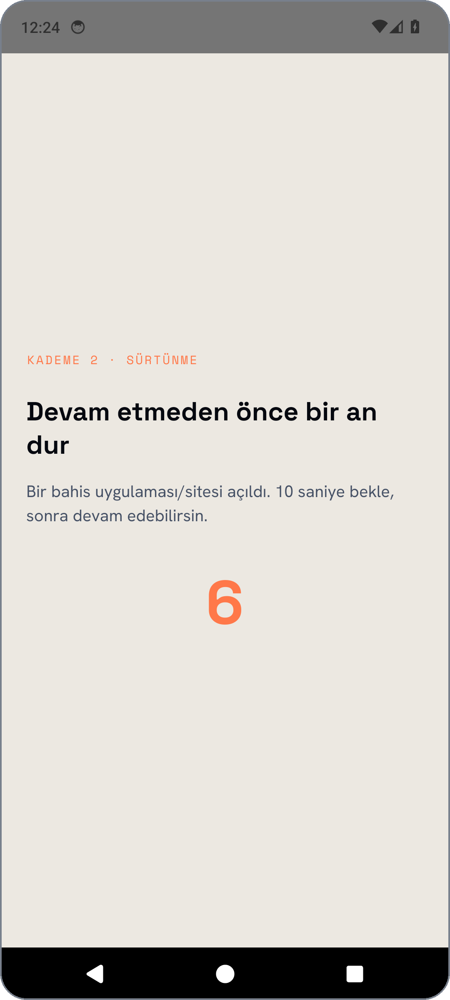<br><sub><b>Tier 2</b><br>10-second pause</sub></td>
    <td align="center">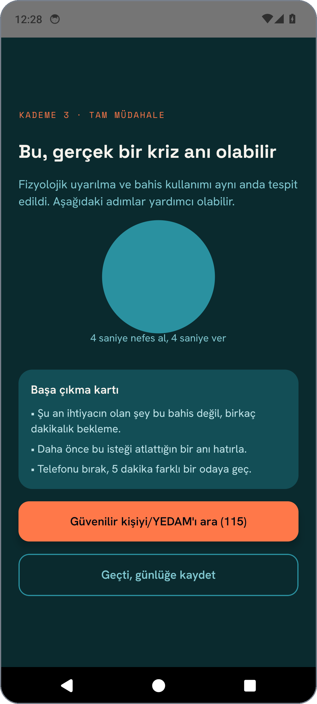<br><sub><b>Tier 3</b><br>breathing, coping card, YEDAM 115</sub></td>
    <td align="center">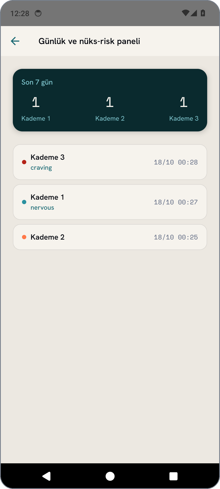<br><sub><b>Diary</b><br>last 7 days by tier</sub></td>
  </tr>
</table>

<sub>Real screenshots of the app (debug build) taken in an Android emulator. The UI language is Turkish. No band was
connected, so the tiers were triggered with the in-app developer simulator, which feeds the real baseline and fusion
engines with synthetic samples: the tier logic genuinely runs, only the input is synthetic.</sub>

### Wristband screen

<table>
  <tr>
    <td align="center">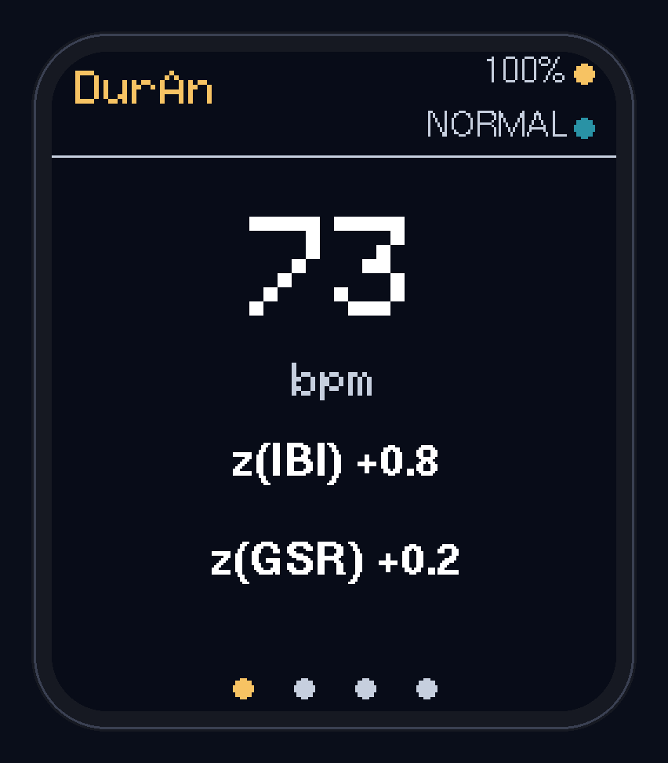<br><sub><b>Normal</b><br>pulse and z-scores</sub></td>
    <td align="center">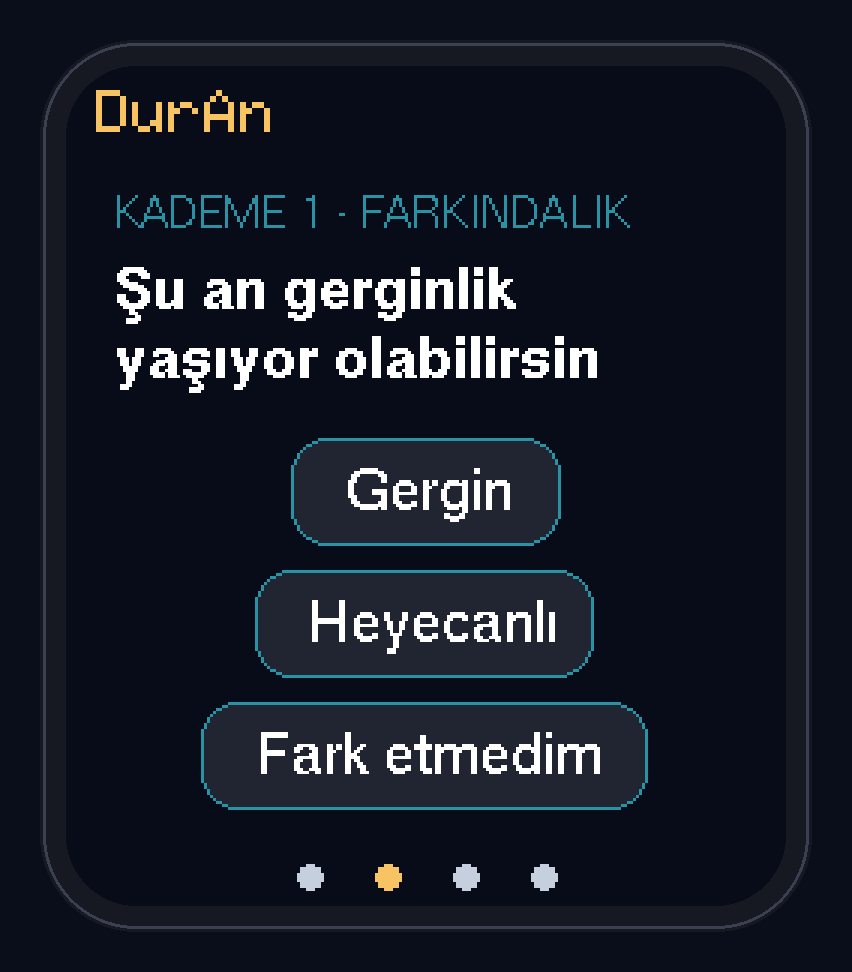<br><sub><b>Tier 1</b><br>awareness + label chips</sub></td>
    <td align="center">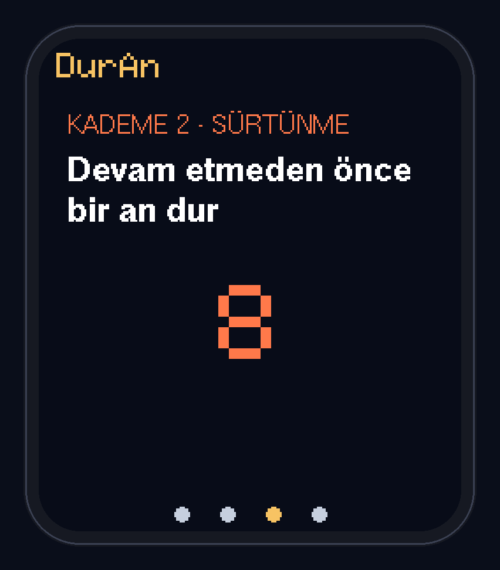<br><sub><b>Tier 2</b><br>friction, countdown</sub></td>
    <td align="center">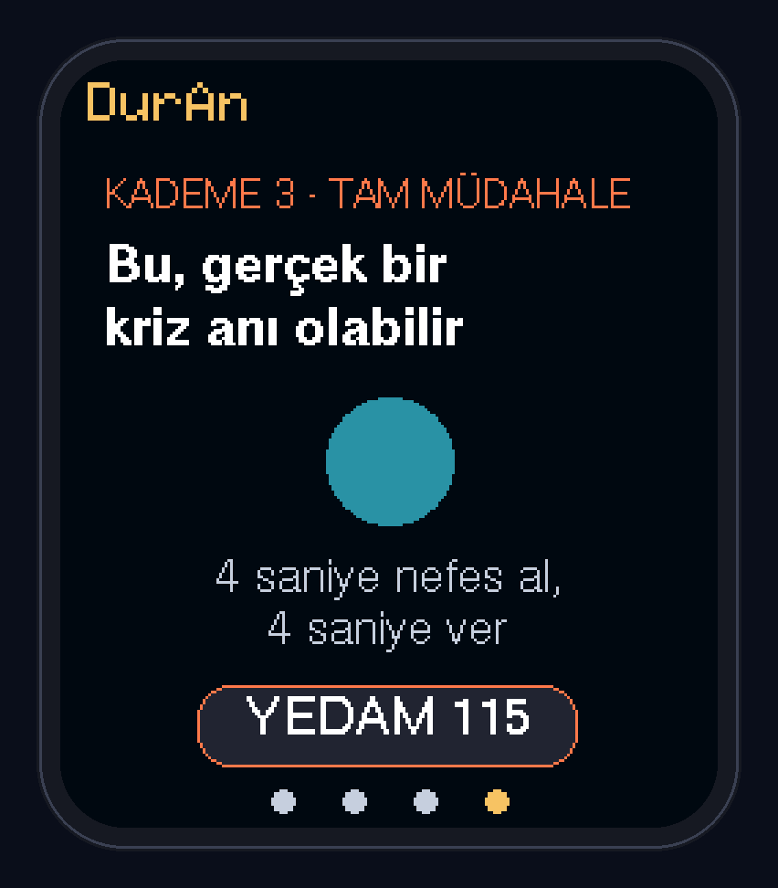<br><sub><b>Tier 3</b><br>breathing + YEDAM 115</sub></td>
  </tr>
</table>

<sub>Frames rendered from the band's display firmware drawing code on a desktop computer (Waveshare ESP32-S3-Touch-LCD-1.69,
240×280). These are render output, not photos of the device, and the sensor values shown are samples.</sub>

## Hardware

<p align="center">
  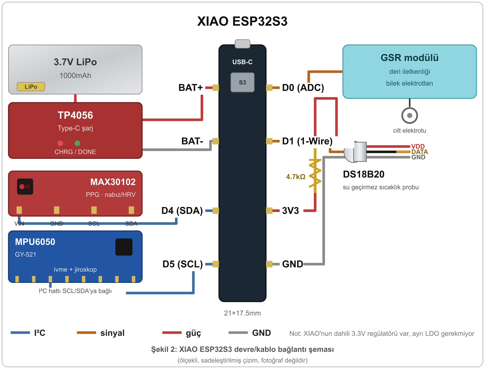<br>
  <sub>XIAO ESP32S3 sensor band wiring (to scale, simplified drawing, not a photo).</sub>
</p>

Bill of materials for the sensor band (6 August 2026 prices, VAT included, Turkish lira):

| Component | Role | Price |
|---|---|---:|
| XIAO ESP32S3 | MCU, BLE 5, USB-C, built-in battery regulator (21 × 17.5 mm) | 559.37 TL |
| MAX30102 | PPG: inter-beat interval, HRV | 72.25 TL |
| Grove GSR | Skin conductance | 631.25 TL |
| DS18B20 (waterproof) | Skin temperature | 73.62 TL |
| MPU6050 (GY-521) | Motion and the motion gate | 147.44 TL |
| 3.7 V 1000 mAh LiPo | Power | 206.36 TL |
| TP4056 Type-C | Charging and protection | 14.74 TL |
| **Total** | | **1,705.03 TL** |

About 1,800–2,000 TL per band including the enclosure and strap.

| Sensor | Pin | Note |
|---|---|---|
| MAX30102 + MPU6050 | SDA → D4, SCL → D5 | shared I²C bus |
| GSR | D0 (ADC) | |
| DS18B20 | D1 (1-Wire) | 4.7 kΩ pull-up required |
| LiPo + TP4056 | BAT+ / BAT− | the XIAO has a built-in regulator |

The watch screen runs on a separate board, the Waveshare ESP32-S3-Touch-LCD-1.69 (ESP32-S3R8 with 8 MB PSRAM, 16 MB flash,
240×280 IPS, CST816T capacitive touch).

## Architecture

The two detectors never talk to each other. They meet only in `FusionEngine`.

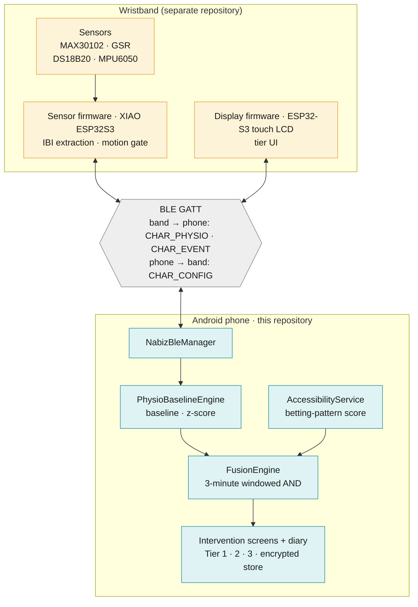

### Tier decision

`FusionEngine.evaluate()` runs every 2 seconds. If both signals were seen in the last 3 minutes the result is Tier 3. If
only one was, the matching tier is chosen.

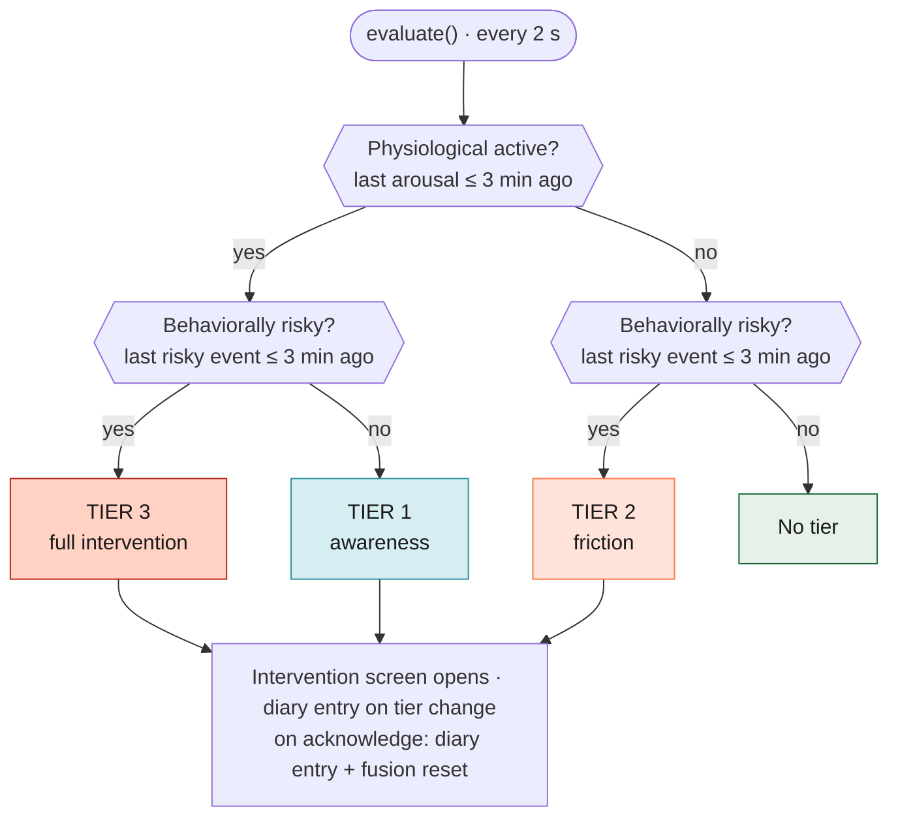

### All logic diagrams

Nine diagrams with explanations and the files where the constants live, in [`docs/logic-diagrams.md`](docs/logic-diagrams.md):

| # | Diagram | PNG |
|---|---|---|
| 1 | System architecture | [01](docs/diagrams/01-system-architecture.png) |
| 2 | BLE session (scan, notifications, commands) | [02](docs/diagrams/02-ble-session.png) |
| 3 | Band: raw PPG signal to a trustworthy inter-beat interval | [03](docs/diagrams/03-band-signal-chain.png) |
| 4 | Phone: rolling baseline, z-score, arousal decision | [04](docs/diagrams/04-phone-baseline-arousal.png) |
| 5 | Behavioral detection (AccessibilityService, pattern score) | [05](docs/diagrams/05-behavioral-detection.png) |
| 6 | Fusion decision | [06](docs/diagrams/06-fusion-decision.png) |
| 7 | Band screen state flow (corner gestures) | [07](docs/diagrams/07-band-screen-flow.png) |
| 8 | App screen flow | [08](docs/diagrams/08-app-screen-flow.png) |
| 9 | Data privacy flow | [09](docs/diagrams/09-data-privacy.png) |

## Design decisions

- **Independent detectors.** Physiological and behavioral detection know nothing about each other and meet only in
  `FusionEngine`, so a failure in one degrades gracefully instead of silencing the system.
- **HRV is computed on the phone.** The MAX30102 reference algorithm gives HR/SpO2 but not HRV. The firmware streams raw
  inter-beat intervals and RMSSD is computed in `PhysioBaselineEngine`, which keeps the firmware simple.
- **No absolute thresholds.** The decision is a z-score (`z ≥ 2`) against a rolling baseline built from the wearer's own
  low-motion samples of the last 48 hours. A one-time calibration would go stale with sleep, caffeine, and circadian rhythm.
- **Motion gate.** Pulse intervals measured while the wrist moves (`|accel − 1000 mg| > 150`) are discarded.
- **A score, not a boolean.** `patternScore = min(n / 5, 1)`, where *n* is how many times the app came to the foreground in
  the last 5 minutes. This reduces false positives from common causes, such as a betting app left open during a football match.
- **On-device, process-and-discard.** Raw sensor streams are never persisted and never uploaded. Only the tier, a timestamp,
  and an optional label are stored, in an encrypted MMKV store whose key lives in the Android Keystore.
- **Wording that avoids a surveillance feel.** The persistent notification says "General health tracking is running".
  Labeling is optional, never mandatory.
- **Independent audit.** A team member audited the causal assumptions of the fusion logic and all four findings were
  addressed in code (common-cause confound, calibration staleness, window validation, adherence limit). See
  [`docs/technical-design.md`](docs/technical-design.md) §6.

## Tech stack

React Native 0.86 (bare CLI, not Expo) · React 19 · TypeScript · Kotlin (native `AccessibilityService` and foreground service) ·
`react-native-ble-plx` · `react-native-mmkv` v4 · `react-native-keychain` · React Navigation 7 · zustand 5 · Jest.
Android `minSdk 24`, `targetSdk 36`, Node ≥ 22.11.

Expo is not an option here, because Expo Go cannot run the custom `AccessibilityService` native module.

## Project structure

```
.
├── App.tsx
├── src/
│   ├── ble/            BLE protocol constants and NabizBleManager (scan, connect, reconnect, commands)
│   ├── engine/         PhysioBaselineEngine, FusionEngine and their Jest tests
│   ├── native/         TypeScript bridge to the Kotlin accessibility service
│   ├── storage/        encrypted DiaryStore and Keystore-backed key
│   ├── store/          zustand store wiring all subsystems together
│   ├── screens/        Onboarding, Home, Intervention, Diary, DeviceScan
│   ├── navigation/     stack navigator
│   └── dev/            __DEV__-only fake data simulator
├── android/            native project, including the Kotlin accessibility and foreground services
├── docs/               logic diagrams, technical design, BLE protocol, images
├── NABIZ_BLE_PROTOCOL.md             BLE contract (Turkish original)
└── MOBIL_UYGULAMA_TEKNIK_TASARIM.md  technical design (Turkish original)
```

## Getting started

Prerequisites: Node ≥ 22.11, JDK and the Android SDK (see the
[React Native environment setup](https://reactnative.dev/docs/set-up-your-environment)), and an Android device or emulator.
BLE needs a physical phone, the emulator has no Bluetooth.

```bash
git clone https://github.com/Anka-1623/NabizApp.git
cd NabizApp
npm install

npm start                # Metro bundler
npm run android          # build and run the debug app (second terminal)

npm test                 # Jest unit tests
npx tsc --noEmit         # type check
npm run lint             # ESLint
```

The debug build shows a **developer mode** panel at the bottom of the Home screen (Calm / Tier 1 / Tier 2 / Tier 3). It
works without a band and is never rendered in release builds.

On Android 13+, a sideloaded build needs *Settings → Apps → App info → ⋮ → Allow restricted settings* before the
accessibility service can be enabled. Release builds are signed with a keystore that is not part of this repository
(see `android/keystore.properties.example`); the build fails loudly if it is missing.

## Status and limits

This is a competition prototype. What is verified and what is not:

| Area | Status |
|---|---|
| **Type check, lint, tests** | `tsc --noEmit` clean, `eslint --max-warnings=0` clean, **14/14 Jest tests pass** (baseline and fusion unit tests plus an app smoke test) |
| **App behavior** | Run in an Android emulator (debug build) with the developer simulator, and all screens in this README were captured there |
| **Live testing with a real band** | Long-running live results are not part of this repository |
| **Band firmware (sensor)** | Implements the BLE contract, but its PPG and motion thresholds still need tuning on a real wrist |
| **Band display firmware** | Runs on the Waveshare board, but its pulse and z-score values come from a simulated generator, not sensors |
| **3-minute fusion window** | Midpoint of the 2–5 minute craving-peak range in the literature, with no direct clinical validation |

Known design limits, stated plainly:

- **Avoidance.** A person in crisis is the one most motivated to take the band off or turn Bluetooth off. This is mitigated
  (neutral wording), not solved.
- **No motion filter on GSR.** The motion gate applies to the pulse interval only.
- **The behavioral signal is frequency-based.** Bet amounts and other content are not read.
- **Sideloaded distribution.** Google Play requires an extra declaration for `AccessibilityService`, so the app is distributed
  outside the Play Store.

## Documentation

- [`docs/technical-design.md`](docs/technical-design.md): engines, accessibility service, storage, screens, build notes
- [`docs/logic-diagrams.md`](docs/logic-diagrams.md): the nine logic diagrams
- [`docs/ble-protocol.md`](docs/ble-protocol.md): UUIDs and byte formats shared with the firmware
- [`NABIZ_BLE_PROTOCOL.md`](NABIZ_BLE_PROTOCOL.md) and [`MOBIL_UYGULAMA_TEKNIK_TASARIM.md`](MOBIL_UYGULAMA_TEKNIK_TASARIM.md): the Turkish originals

---

<p align="center"><sub>Stratos Root · TEKNOFEST 2026</sub></p>
