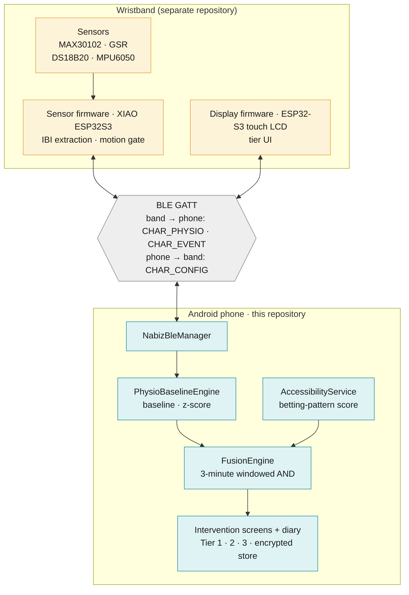
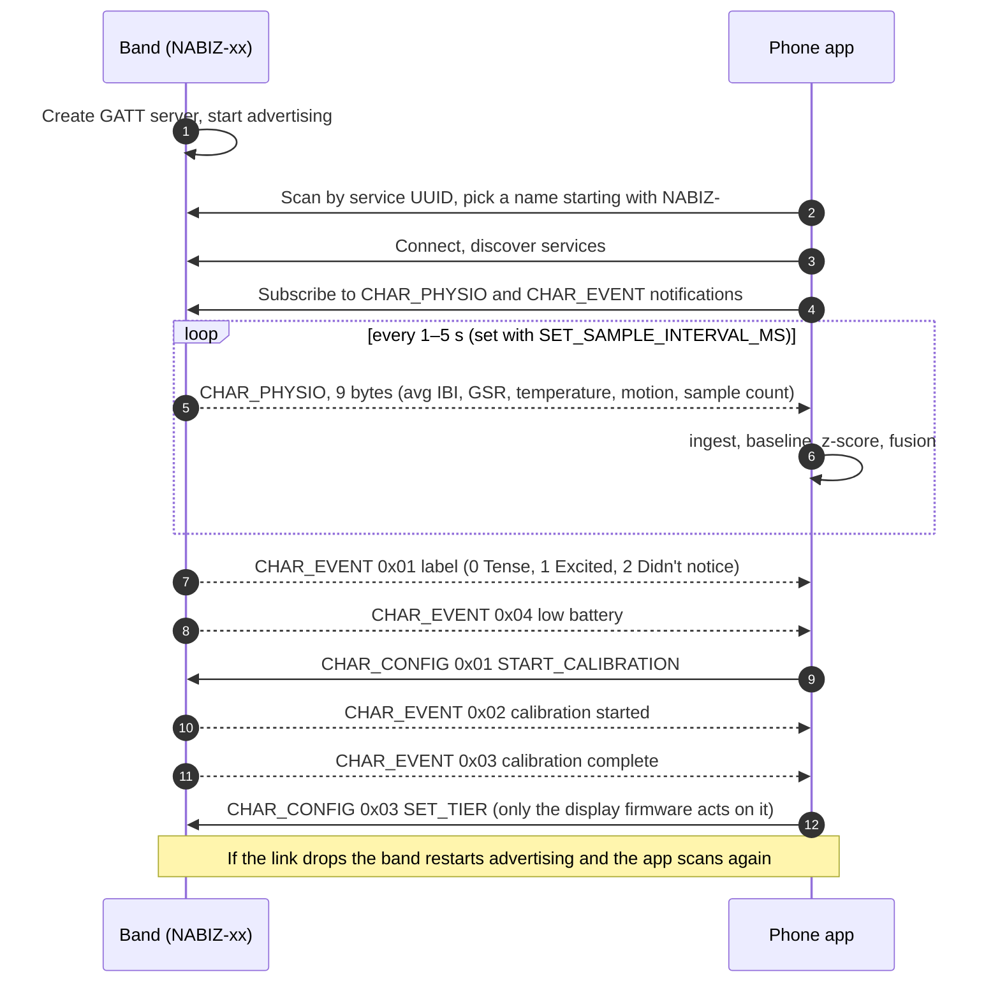
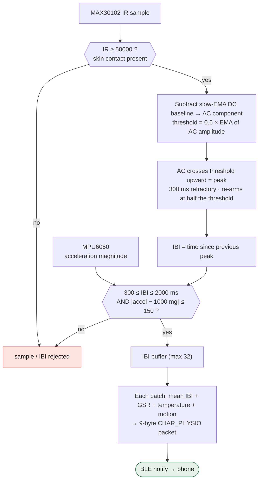
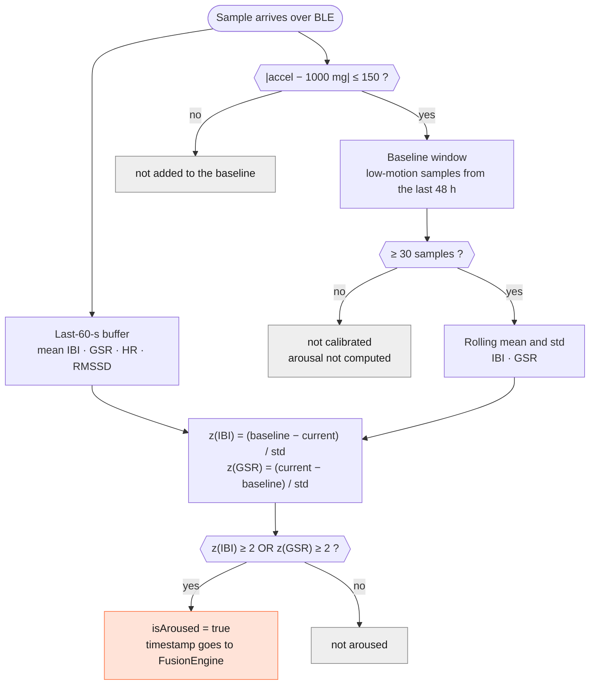
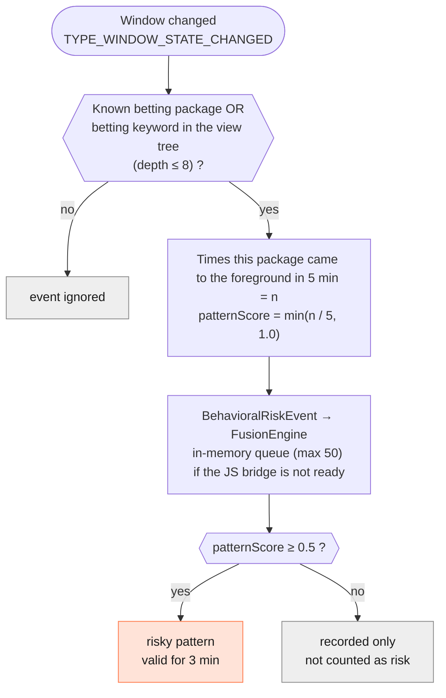
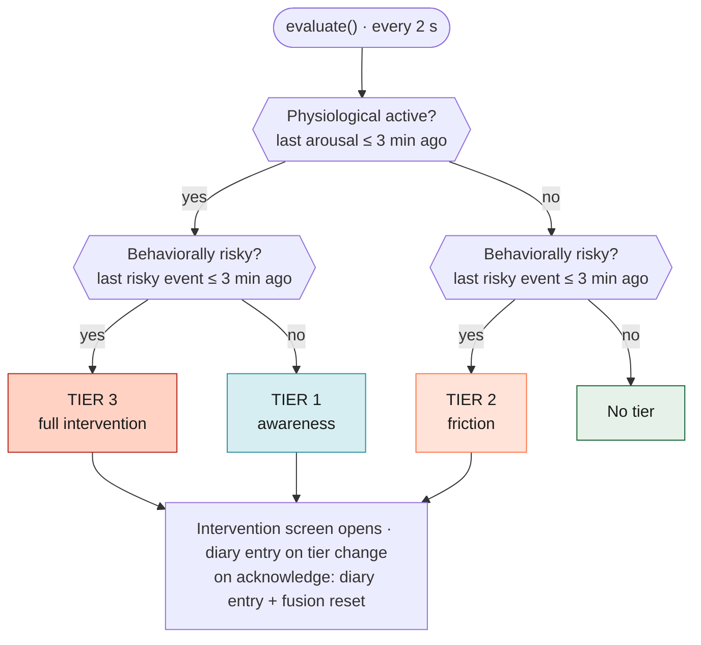
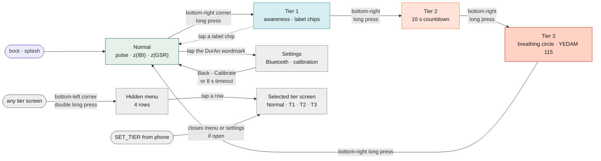
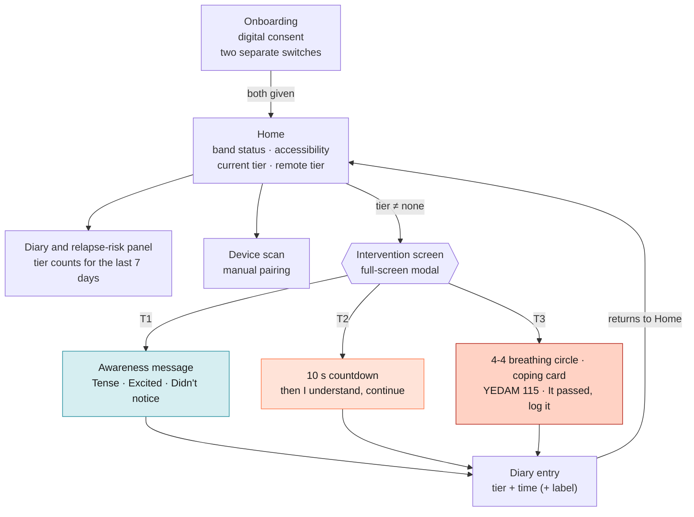
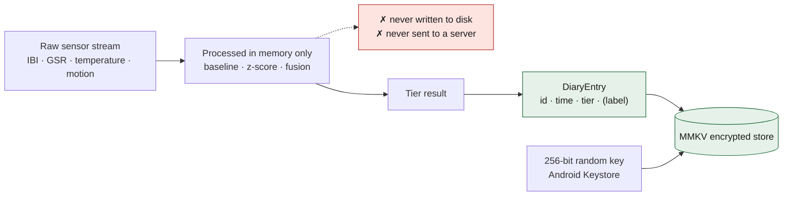

# DurAn — Logic diagrams

This page shows how decisions are made inside the system. The diagrams were drawn from the source code, and each
section names the file where the constants live. GitHub renders them inline. PNG exports of the same diagrams are in
[`diagrams/`](diagrams) for slides and portfolio use.

> Parts marked *band firmware* run on the wristband and live in a separate repository. Everything else is in this one.

| # | Diagram | What it shows |
|---|---------|---------------|
| 1 | [System architecture](#1-system-architecture) | Band, phone, and the data path between them |
| 2 | [BLE session](#2-ble-session) | Scanning, connecting, notifications, and commands |
| 3 | [Band: raw signal to inter-beat interval](#3-band-raw-signal-to-inter-beat-interval) | From a PPG sample to a trustworthy IBI and a BLE packet |
| 4 | [Phone: baseline and arousal](#4-phone-baseline-and-arousal) | From IBI/GSR to a personal z-score and an "aroused" decision |
| 5 | [Behavioral detection](#5-behavioral-detection) | How betting-app usage becomes a score |
| 6 | [Fusion decision](#6-fusion-decision) | How two signals become Tier 0–3 |
| 7 | [Band screen flow](#7-band-screen-flow) | Gestures and transitions on the watch screen |
| 8 | [App screen flow](#8-app-screen-flow) | The user path from onboarding to the diary |
| 9 | [Data privacy flow](#9-data-privacy-flow) | What is stored and what is not |

---

## 1. System architecture

Two independent detectors meet only at the fusion layer. If one stops working, the other keeps running at its own tier.
On the band side there are currently two hardware tracks: the sensor firmware (real sensors, not yet validated on a
physical board) and the display firmware (its sensor values are simulated). See [Status and limits](../README.md#status-and-limits).

---

## 2. BLE session

The service and its three characteristics are the single contract between firmware and app
([`ble-protocol.md`](ble-protocol.md), `src/ble/protocol.ts`). The service UUID is `6e400001-b5a3-f393-e0a9-e50e24dcca9e`
and the device name starts with `NABIZ-`.

| Characteristic | Direction | Payload |
|---|---|---|
| `CHAR_PHYSIO` `…0002` | band → phone, Notify | 9 bytes, little-endian: `avgIbiMs` u16 · `gsrRaw` u16 · `tempCentiC` i16 · `accelMagMg` u16 · `sampleCount` u8 |
| `CHAR_EVENT` `…0003` | band → phone, Notify | 1–2 bytes: `0x01` label (+index) · `0x02` calibration started · `0x03` complete · `0x04` low battery |
| `CHAR_CONFIG` `…0004` | phone → band, Write | `0x01` calibrate · `0x02` sample interval (+u16 ms) · `0x03` select tier (+tier) |

HRV (RMSSD) is not computed on the band. The firmware only streams raw inter-beat intervals and the statistics are
computed on the phone.

---

## 3. Band: raw signal to inter-beat interval

*Band firmware.* The peak threshold is not a fixed number, it adapts to the signal's own AC amplitude. The motion gate
keeps beat intervals measured while the wrist is moving out of the packet.

At rest the acceleration magnitude is about 1 g (1000 mg), not zero, so the comparison is on `|accel − 1000 mg|`.
All constants are tuning values that still need validation on a real wrist.

---

## 4. Phone: baseline and arousal

`src/engine/PhysioBaselineEngine.ts`. The decision is not based on an absolute threshold. It is a z-score against the
person's own low-motion samples from the last 48 hours. A rolling window is used instead of a one-time calibration
because sleep, caffeine, and circadian rhythm shift the baseline over time.

The sign of z(IBI) is flipped: a shorter IBI means a faster pulse, which is the arousal direction. The motion gate applies
to the pulse interval only. The GSR channel is not motion-filtered (benchmarks suggest motion features do not improve
EDA artifact detection), which is left as future work.

---

## 5. Behavioral detection

The Android `AccessibilityService` is event-driven, so unlike the high-frequency BLE path it is cheap on battery. The
signal is not a "betting app is open" boolean, it is a **frequency-based score**. This avoids the false positive where a
betting app simply stays open while someone watches a match.

Known packages: `iddaa`, `nesine`, `misli`, `tuttur`, `bilyoner`. The keyword path (for example `canlı bahis`,
`deneme bonusu`, `güncel giriş`) exists to catch mirror sites of blocked domains. The persistent notification text says
"General health tracking is running" on purpose and never mentions betting or gambling.

---

## 6. Fusion decision

`FusionEngine.evaluate()` runs every 2 seconds. The window is 3 minutes: the midpoint of the 2–5 minute range reported
for craving peaks. It is a tunable constant and has no direct clinical validation.

| Physiological | Behavioral | Result | Intervention |
|:-:|:-:|---|---|
| – | – | No tier | — |
| ✓ | – | **Tier 1** | Short awareness message, optional one-tap label |
| – | ✓ | **Tier 2** | "Pause for a moment before continuing", 10-second countdown |
| ✓ | ✓ | **Tier 3** | 4-4 breathing circle, coping card, YEDAM 115 (one-tap call in the app) |

Source: `src/engine/FusionEngine.ts`. Tier transitions are covered by `FusionEngine.test.ts`.

---

## 7. Band screen flow

*Display firmware.* Navigation on the watch is done entirely with touch gestures at the screen corners. A tier change uses a
240 ms cross-dissolve, and entering Tier 3 plays a short beep.

The hidden menu and corner gestures are for the jury or demo operator and are not part of the end-user flow. Tapping a
label chip on Tier 1 sends `CHAR_EVENT 0x01` to the phone and returns the screen to Normal.

---

## 8. App screen flow

`InterventionScreen` opens as a full-screen modal and cannot be swiped away. Labeling on Tier 1 is optional (a mandatory
question on every trigger would defeat the purpose of passive sensing, so it was deliberately rejected).

---

## 9. Data privacy flow

Raw physiological data is never written to disk and never sent to a server. The only thing persisted is the tier, a
timestamp, and an optional label. This is a deliberate architectural decision to keep biometric-data risk to a minimum.

The in-app digital consent does not replace the paper-based KVKK (Turkish data-protection law) explicit-consent form,
which is handled separately.
